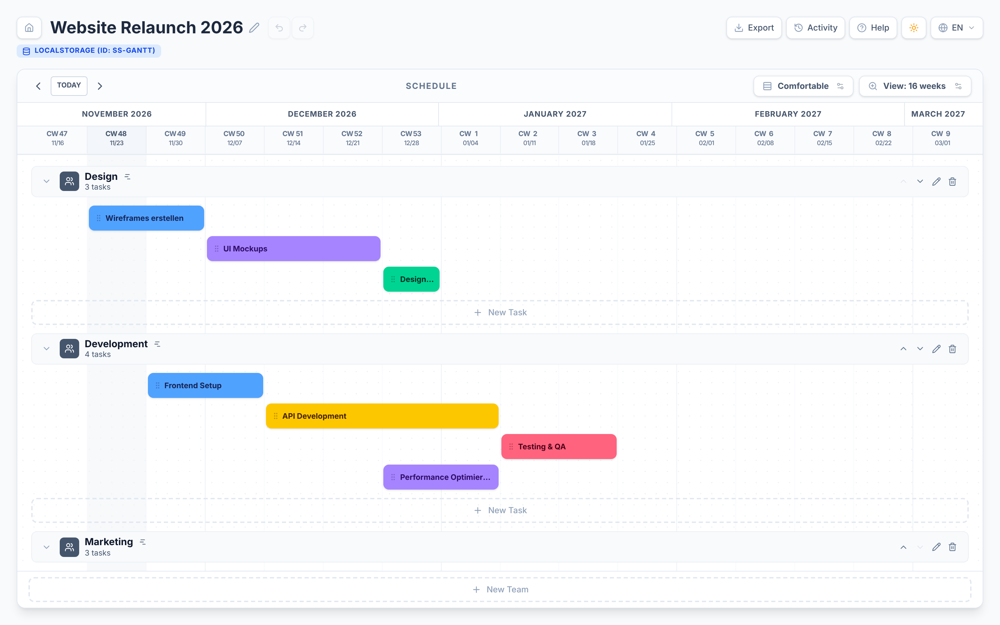
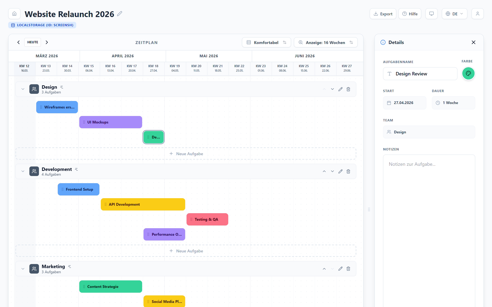
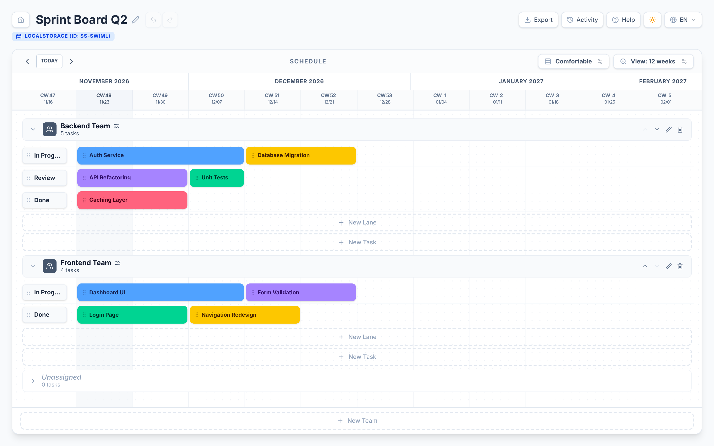
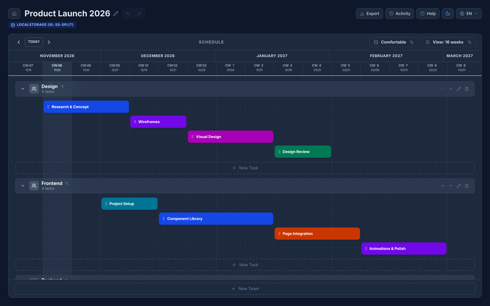
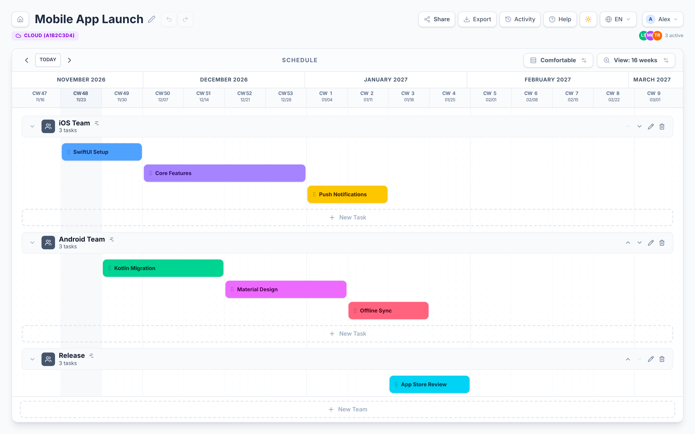
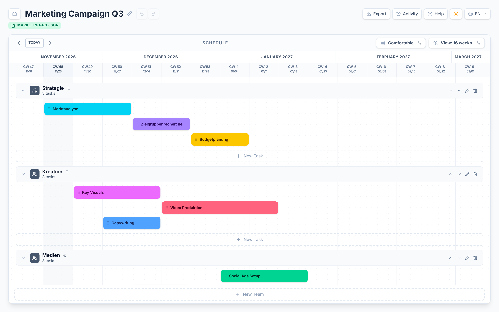
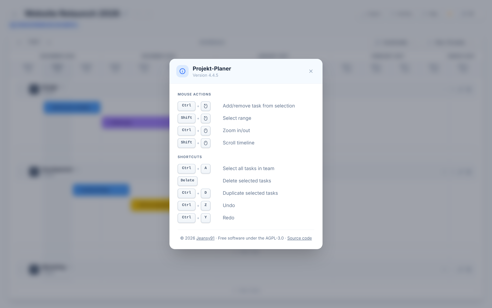

# Projekt-Planer

Projekt-Planer is an interactive project planner with a Gantt chart and a swimlane view. Projects are stored in the browser, in a local file or in Supabase for collaboration in the cloud. The interface is available in German and English.

## Features

- Gantt chart with tasks as bars on a calendar-week grid
- Swimlane view as an alternative board layout of the same tasks
- Drag & drop to move tasks and resize their duration
- Teams to group tasks; create, rename, collapse and reorder them
- 8 colors for visual categorization
- Multi-select with Ctrl+click / Shift+click for bulk operations
- Zoom (4–52 weeks) and adjustable row density
- Undo / redo and keyboard shortcuts
- Rich-text notes per task
- Dark mode
- Storage in LocalStorage, a local file (File System Access API) or Supabase (cloud projects, sharing, collaboration)
- Offline support: local projects stay available after the first successful load
- JSON import and export
- Two languages: German (`de`) and English (`en`)

## Screenshots

| Gantt overview | Task details |
|---|---|
|  |  |
| **Swimlane view** | **Dark mode** |
|  |  |

<details>
<summary>More: collaboration, import/export, shortcuts</summary>





</details>

## Stack

- **Frontend**: React, Vite, Tailwind CSS, BlockNote (rich-text notes), Lucide icons
- **i18n**: react-i18next
- **Cloud backend (optional)**: Supabase (auth, Postgres with Row Level Security, Edge Functions)
- **Serving**: NGINX in a Docker image
- **Tests**: Vitest, Playwright

## Quick Start

### Docker (recommended)

A ready-made image is published to the GitHub Container Registry on every release.

```bash
docker run -d --name projekt-planer \
  -p 8080:80 \
  --restart unless-stopped \
  ghcr.io/jeansy91/projekt-planer:latest
```

The app runs on `http://localhost:8080`. Without further configuration only local projects (browser and file) are available. For cloud projects, pass the Supabase settings (see [Configuration](#configuration)):

```bash
curl -o .env https://raw.githubusercontent.com/Jeansy91/projekt-planer/main/.env.example
```

Instead of `latest` you can pin a version, for example `ghcr.io/jeansy91/projekt-planer:<version>`. All versions are listed under [Releases](https://github.com/Jeansy91/projekt-planer/releases).

With Docker Compose:

```yaml
services:
  projekt-planer:
    image: ghcr.io/jeansy91/projekt-planer:latest
    env_file: .env
    ports:
      - "8080:80"
    restart: unless-stopped
```

To build the image yourself, run `docker build -t projekt-planer .` in the repository.

### Local Development

Requirements: Node.js and, for cloud features, Docker. Yarn is checked into the repository, `corepack enable` is enough.

```bash
corepack enable
yarn install
yarn dev
```

The app runs on `http://localhost:5173`.

For accounts, sharing and realtime, start a local Supabase with `yarn supabase start` and put its URL and key into `.env` (see [Development](docs/development.md)).

Run the tests:

```bash
yarn test                    # unit tests (Vitest)
yarn playwright install --with-deps chromium
yarn test:e2e                # E2E tests with local projects, the dev server must be running
yarn test:e2e:cloud          # E2E tests for accounts and sharing, needs the local Supabase
```

## Configuration

All settings are read from environment variables. See [`.env.example`](.env.example) for a template. The frontend values are written to `env-config.js` at container start, so one image works for every environment.

| Variable | Description | Used by |
|---|---|---|
| `SUPABASE_PROJECT_URL` | URL of your Supabase project. Without it, cloud projects are disabled. | Frontend |
| `SUPABASE_PUBLISHABLE_KEY` | Publishable (anon) key of your Supabase project | Frontend |
| `DATABASE_URL` | Postgres connection string. If set, pending migrations from `supabase/migrations/` are applied at start. | Entrypoint |
| `SUPABASE_ACCESS_TOKEN` | Supabase Management API token, deploys the Edge Functions | Entrypoint |
| `SUPABASE_PROJECT_REF` | Supabase project reference | Entrypoint |
| `PROJEKT_PLANER_URL` | Public URL of your instance, set as the Supabase auth `site_url` | Entrypoint |
| `SMTP_HOSTNAME`, `SMTP_PORT`, `SMTP_USERNAME`, `SMTP_PASSWORD`, `SMTP_FROM` | SMTP settings, stored as Edge Function secrets | Entrypoint |

Never pass `SUPABASE_ACCESS_TOKEN` or `DATABASE_URL` to `yarn dev` or `yarn build`: every `SUPABASE_*` variable ends up in the browser bundle. See [SECURITY.md](SECURITY.md) for more.

## Documentation

- [User guide](docs/user/README.md)
- [Architecture](docs/architecture.md), [development](docs/development.md), [configuration](docs/configuration.md) and [deployment](docs/deployment.md)
- [Database](docs/database.md), [Edge Functions](docs/edge-functions.md), [security](docs/security.md) and [troubleshooting](docs/troubleshooting.md)
- [Glossary](docs/glossary.md) and [architecture decisions](docs/adr/)

## CI, Security and Releases

### Build workflow

`.github/workflows/build-image.yml` runs on every pull request, on every push to `main` and on manual dispatch:

1. Unit tests and a production build.
2. Security checks from `.github/workflows/security.yml` (see below).
3. On pull requests: the E2E tests from `.github/workflows/e2e.yml`, with local projects and against a local Supabase.
4. Builds the Docker image and starts it once in a container as a smoke test.
5. On `main` only: pushes the image to `ghcr.io/jeansy91/projekt-planer`, commits the new version to `package.json` and creates a GitHub release.

The E2E tests also run on every push to `main` as a separate workflow, outside the publishing path. Details in [CI/CD](docs/ci-cd.md).

### Automatic releases

Every push to `main` with relevant changes creates a new release. The next version is derived from the [Conventional Commits](https://www.conventionalcommits.org/) since the last tag:

| Commits since the last release | Version bump |
|---|---|
| `feat!:`, `fix!:` … or a `BREAKING CHANGE` footer | major |
| `feat:` | minor |
| `fix:`, `chore(deps):` and anything else | patch |
| only `ci:`, `docs:`, `test:`, `style:` or `chore:` (except `chore(deps)`) | no release |

The image is tagged with `latest`, the commit SHA and the version without the `v`. The release notes are generated by GitHub.

### Dependency updates

Dependabot (`.github/dependabot.yml`) checks the npm packages (including the Supabase CLI), the Docker base images and the GitHub Actions every Monday. Patch and minor updates are merged automatically once CI passes, which then triggers a new release. Major updates wait for a manual review.

### Security checks

`.github/workflows/security.yml` runs as part of every build and additionally every Monday:

- `yarn npm audit` checks `yarn.lock` for known vulnerabilities.
- `gitleaks` scans the whole Git history for committed secrets.

See [SECURITY.md](SECURITY.md) for how to report a vulnerability.

## Project Structure

```
src/                    # React app: components, hooks, persistence, utils, locales
supabase/
  migrations/           # Database schema and Row Level Security
  functions/            # Edge Functions
  email-templates/      # Auth emails
  config.toml           # Local Supabase stack
e2e/
  tests/                # E2E tests with local projects
  cloud/                # E2E tests against Supabase
docker/                 # nginx.conf and the container entrypoint
docs/                   # User guide, technical docs, ADRs
public/                 # Static assets and screenshots
scripts/                # Screenshot generator
Dockerfile
```

See [Architecture](docs/architecture.md) for details.

## Contributing

Contributions are welcome. Please read [CONTRIBUTING.md](CONTRIBUTING.md) first.

## Support

If you like Projekt-Planer, you can support its development on [Ko-fi](https://ko-fi.com/jeansy91).

## License

Projekt-Planer is free software under the [GNU Affero General Public License v3.0 or later](LICENSE). If you run a modified version for other people, for example as a hosted service, you have to offer them your modified source code.
