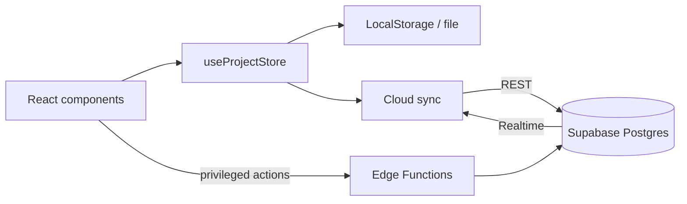

# Architecture

Projekt-Planer is a single-page application built with React and Vite. Without configuration it works entirely in the browser. With a Supabase project it adds accounts, cloud projects and real-time collaboration. There is no custom API server: Supabase provides auth, database, realtime and storage, and a few Edge Functions handle the operations that need the service role.

## Layers

| Layer | Technology | Responsibility |
|---|---|---|
| UI | React, Tailwind CSS, Lucide icons, BlockNote | Rendering, state through hooks |
| Routing | react-router-dom | Landing page, dashboard, project view, settings |
| i18n | i18next, react-i18next | German and English, browser language detection |
| Local persistence | LocalStorage, File System Access API | Projects without an account |
| Auth | Supabase Auth | Email and password, JWT, TOTP MFA |
| Database | Supabase Postgres | Cloud projects, Row Level Security |
| Realtime | Supabase Realtime | Live updates between collaborators |
| Storage | Supabase Storage | Avatars (bucket `avatars`) |
| Edge Functions | Supabase Edge Runtime (Deno) | Change email or password, delete account, MFA enrollment, invitations |
| Hosting | NGINX in Docker | Static files, SPA fallback, runtime config |

## Data flow



Local projects are written to LocalStorage or a file on every change. Cloud projects go through the cloud sync: changes are flushed to Postgres, and changes from other users arrive over the Realtime channel. Echoes of a user's own writes are filtered out by fingerprint, see the [glossary](glossary.md) for the terms.

Concurrent edits to the same row follow last-writer-wins, see [ADR 0001](adr/0001-no-occ-on-concurrent-edits.md).

## Frontend structure

```
src/
  App.jsx                 Project view, composes the hooks and renders the layout
  AppRouter.jsx           Routes, auth state and cloud availability
  main.jsx                Entry point
  i18n.js                 i18next configuration
  components/             One component per file
    dialogs/              One dialog per file, re-exported from index.js
      auth/               Login, registration, MFA and password steps
      share/              Share dialog, member list and roles
    settings/             Settings page sections
  hooks/                  One concern per hook
    useProjectStore.js    Composes project state, view and the action hooks
    useProjectState.js    Project shape: id, title, teams, tasks
    useProjectView.js     Per-user view (visible range, collapsed groups)
    use*Actions.js        Task, team and lane actions
    useDragDrop.js        Drag intake: lifecycle, hover, source and target
    useUndoRedo.js        Undo and redo, persisted history
    useCloudSync.js       React binding of the cloud sync coordinator
    useRealtimeChannel.js Realtime transport: subscribe, reconnect, dispatch
  persistence/            LocalStorage and file system persistence
  utils/                  Pure functions, grouped by domain
    dragProjection.js     projectDrag(): next task state for a drag
    cloudSync*.js         Cloud sync coordinator, core logic and loaders
    historyCore.js        History entry schema
  locales/                de.json, en.json
```

Unit tests sit next to the code they test (`*.test.js`).

## Backend

- **Auth:** email and password with optional TOTP MFA. Sensitive account operations require AAL2 for users with MFA, enforced in the Edge Functions.
- **Database:** Row Level Security on every table. Helper functions (`is_project_member`, `is_project_editor`, `get_project_owner`) avoid circular policy dependencies. Details in [Database](database.md).
- **Realtime:** enabled for `projects`, `teams`, `lanes`, `tasks` and `project_members`.
- **Storage:** public bucket `avatars`, each user writes only below their own user ID.
- **Edge Functions:** described in [Edge Functions](edge-functions.md).

## Runtime configuration

The Docker image contains no environment-specific values. At container start, `docker/entrypoint.sh` writes `env-config.js` with the Supabase URL and publishable key, so one image works for every environment. In development, Vite reads the same variables from `.env`. See [Configuration](configuration.md).
