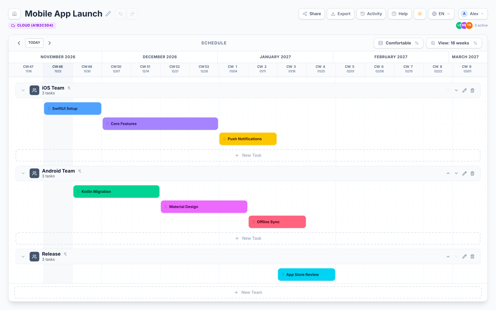

# Collaboration

Cloud projects enable real-time collaboration with multiple users. Invite team members and assign roles.

**Requirement:** Collaboration requires an account. Sign in or register to create and share cloud projects.

## Creating a cloud project

1.  Sign in with your account.
2.  Click **New Project** and choose **Cloud Project**.
3.  The project is saved in the cloud and immediately accessible via your account.

## Inviting members

1.  Open the cloud project.
2.  Click the **Share** button in the header.
3.  Enter the member's email address and click **Invite**.
4.  The invited member receives an email. They must register first to get access.

## Roles and permissions

| Role       | Read | Edit | Manage members | Delete project |
|------------|------|------|----------------|----------------|
| **Owner**  | Yes  | Yes  | Yes            | Yes            |
| **Admin**  | Yes  | Yes  | Yes            | No             |
| **Editor** | Yes  | Yes  | No             | No             |
| **Viewer** | Yes  | No   | No             | No             |

## Managing members

In the Share dialog you see all current members with their roles. As Owner or Admin you can:

- Resend invitations (**Resend**)
- Remove members (**Remove**)
- Change roles (via the role dropdown next to the member)
- Transfer ownership (**Transfer Ownership**)

## Leaving a project

As a member (not owner) you can leave a project via **Share → Leave Project**. After leaving, you lose access.

## Converting a local project to cloud

An existing local project can be converted to a cloud project. Click the storage badge in the header and select **Convert to Cloud**. All data is transferred to the cloud.

## Active users

In cloud projects, the header shows how many users currently have the project open. Changes from other users are synchronized in real time.
