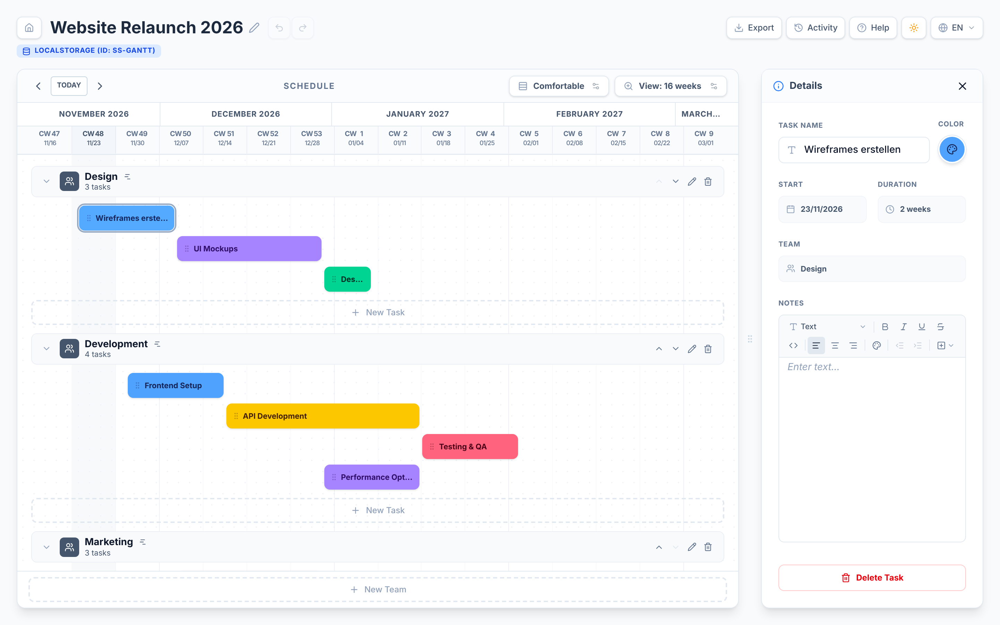

# Gantt Chart

The Gantt view displays tasks as horizontal bars on a timeline. Move and resize tasks using drag & drop.

## Creating tasks

There are two ways to create a new task:

- Click the **New Task** button below a team.
- Click directly in the empty Gantt area of a team – a new task is created at the clicked calendar week position.

After creation, the task is automatically selected and the detail panel opens on the right.

## Moving tasks

Drag a task bar horizontally on the timeline to shift it in time. A live preview is shown while dragging. When released, the task snaps to the nearest full calendar week.

**Note:** Tasks cannot be dragged outside the visible time range. The range is limited by the zoom setting.

## Changing duration

Resize handles (small strips) appear on the left and right edges of each bar. Drag an edge to extend or shorten the duration. The minimum duration is 1 week.

## Selecting tasks

| Action        | Result                                |
|---------------|---------------------------------------|
| Click on task | Single selection – opens detail panel |
| Ctrl+Click    | Add/remove task from multi-selection  |
| Shift+Click   | Select range between two tasks        |
| Ctrl+A        | Select all tasks in the team          |

## Deleting tasks

Select one or more tasks and press Delete (Windows) or ⌘+⌫ (Mac). A confirmation dialog will appear.

## Detail panel

Clicking a task opens the detail panel on the right with the following fields:

- **Task Name:** Free text input
- **Color:** Color picker (10 preset colors)
- **Start:** Calendar week start date
- **Duration:** Number of weeks
- **Team:** Team assignment
- **Notes:** Multi-line text field for comments
