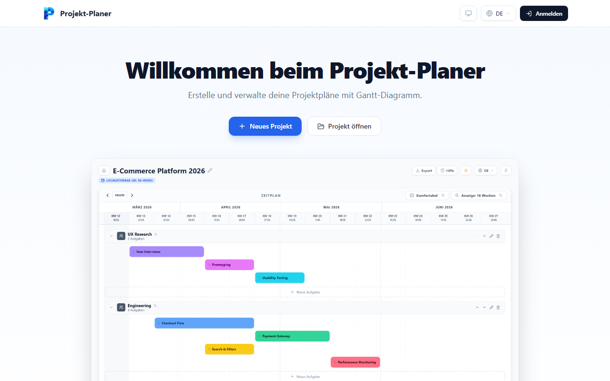

# Getting Started

Get your first project up and running in a few steps. This guide explains storage modes, creating your first task and the basic layout of the interface.

## Choose a storage mode

Three storage modes: LocalStorage (browser cache), File System (JSON file), Cloud (Supabase)

| Mode             | Storage location  | Login | Shareable       |
|------------------|-------------------|-------|-----------------|
| **LocalStorage** | Browser cache     | No    | No              |
| **File System**  | Hard drive (JSON) | No    | Via file export |
| **Cloud**        | Supabase          | Yes   | Yes             |

## Create your first project

1.  Click **Local Project** on the start page (no login needed) or **Sign In** for cloud projects.
2.  The project opens immediately with the default title *Task Planning*. You can edit the title directly in the top bar.
3.  Use the **New Project** menu anytime to create another project or switch storage locations.

## User interface

The interface consists of three main areas:

- **Header:** Project title, storage badge, action buttons (New, Open, Export, Help, Activity) and language selector.
- **Calendar header:** Horizontal timeline with months, calendar weeks and zoom/density controls.
- **Main area:** Teams with Gantt bars or Swimlane lanes. The button to add new teams is at the bottom.

**Note:** The storage badge in the header shows the current storage mode (e.g. `LocalStorage (ID: abc123)` or `Cloud`).

## Create your first task

1.  Click **New Team** to create a group.
2.  Click **New Task** within the team or directly in the Gantt area.
3.  Enter a task name and confirm with Enter.
4.  The task appears as a colored bar on the timeline – drag it to move or drag the edges to change its duration.
5.  Click the task to edit color, start, duration and notes in the detail panel on the right.

**Tip:** Press Ctrl+D (Windows) or ⌘+D (Mac) to duplicate selected tasks.
