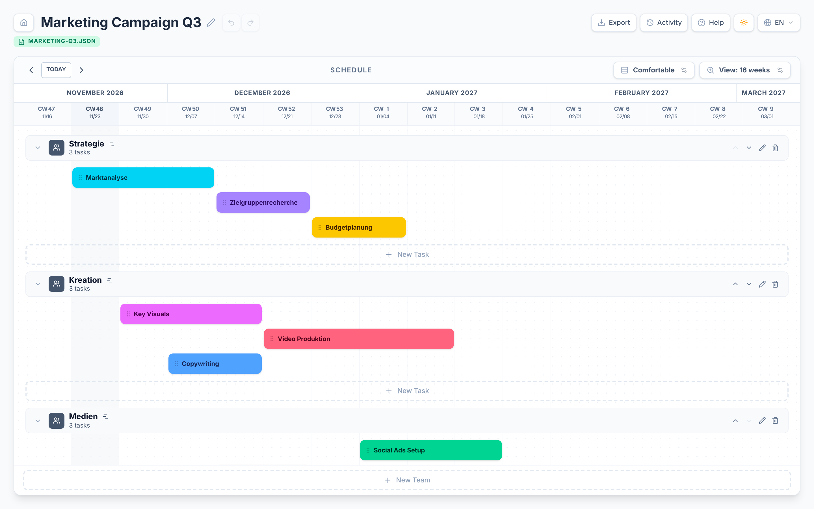

# Import / Export

Save projects as JSON files, share them, or import them on another device. The JSON format is open and documented.

## Exporting a project

1.  Click the **Export** button in the project header.
2.  A dialog asks whether to include the **activity log**:  
    – **Include Log:** Contains the full undo history.  
    – **Without Log:** Smaller file, history is lost.
3.  The browser saves the file as `.json` in the default downloads folder.

**Note:** The file name matches the project title. Special characters are automatically sanitized.

## Importing a project

There are two ways to import a JSON file:

### Via "Open Project"

1.  Click **Open Project** in the header.
2.  In the dialog under **External Sources**, choose **Open File** or **JSON Import**.
3.  Select the `.json` file from your hard drive.
4.  The project is loaded and saved to LocalStorage.

### From the start page

1.  Click **Open File** on the start page.
2.  Select a `.json` project file.

## File System mode

Projects can also be linked directly to the file system (File System Access API). In this mode, the file is automatically updated on every change – no manual export needed.

- Create a file system project via **New Project → File System**.
- Choose a location on your hard drive.
- Changes are written to the file immediately.

**Browser compatibility:** The File System Access API is fully supported by Chrome and Edge. Firefox and Safari have limited or no support. For maximum compatibility, use JSON export/import.

## JSON format

The exported file is a structured JSON file with the following main fields:

- `title` – Project title
- `teams` – Array of all teams with view mode, color and lanes
- `tasks` – Array of all tasks with start, duration, color, notes and team assignment
- `zoom` – Current zoom level
- `density` – Current row height
- `history` – (Optional) Activity log
