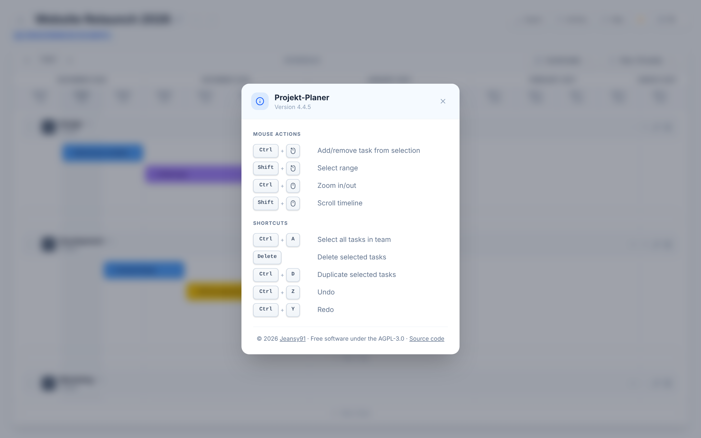

# Shortcuts

All keyboard shortcuts at a glance. The info dialog (**?** in the header) shows the same list for your platform.

| Action | Mac | Windows / Linux |
|---|---|---|
| Add or remove a task from the selection | ⌘ + click | Ctrl + click |
| Select a range | ⇧ + click | Shift + click |
| Select all tasks in the team | ⌘ + A | Ctrl + A |
| Delete selected tasks | ⌘ + ⌫ | Delete |
| Duplicate selected tasks | ⌘ + D | Ctrl + D |
| Undo | ⌘ + Z | Ctrl + Z |
| Redo | ⇧ + ⌘ + Z | Ctrl + Y |
| Zoom in or out | ⌘ + scroll | Ctrl + scroll |
| Scroll the timeline | ⇧ + scroll | Shift + scroll |

## Mouse gestures

| Action | Gesture |
|---|---|
| Move a task | Drag the bar |
| Change the duration | Drag the left or right edge |
| Rename a team or lane | Double-click the name |

On touch devices, drag & drop works with touch. Keyboard shortcuts are not available there.
