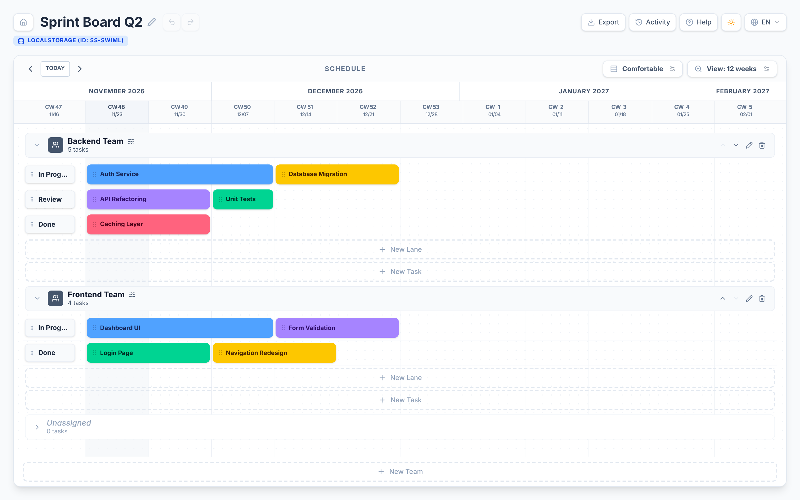

# Swimlane View

The swimlane view organizes tasks in vertical lanes (columns). Each team can independently operate in Gantt or Swimlane mode.

## Choosing a view mode

Each team can be displayed individually in Gantt or Swimlane mode. When creating a team, choose the desired mode. You can switch modes later via the team menu (double-click the team name or use the context menu).

## Managing lanes

In Swimlane mode you see vertical lanes. You can:

- **Add a new lane:** Click the **+ New Lane** button.
- **Rename a lane:** Double-click the lane title.
- **Delete a lane:** Click the delete icon in the lane header. Tasks in that lane are also deleted.

**Warning:** Deleting a lane also deletes all tasks it contains. This action cannot be undone.

## Staging area

The **Unassigned** staging area collects tasks not yet assigned to any lane. This is useful as a backlog or buffer. Tasks from staging can be dragged into a lane.

## Dragging tasks between lanes

Tasks can be dragged between lanes and calendar weeks. While dragging, the swimlane shows a preview of the target position. On drop, the task is assigned to the corresponding lane and week.

## Multi-selection in swimlanes

Multi-selection (Ctrl+Click, Shift+Click, Ctrl+A) and bulk operations (delete, move) are also available in the swimlane view.
