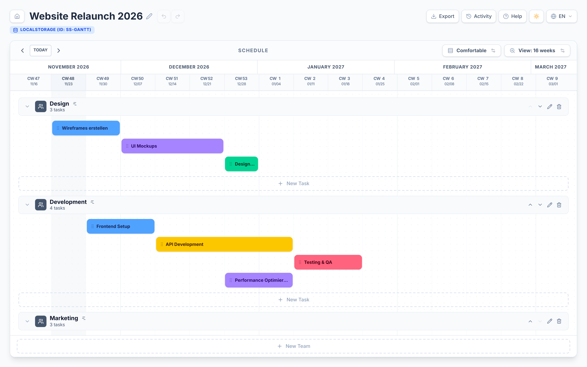

# Teams

Teams group tasks and define whether they are displayed in Gantt or Swimlane mode. Each project can contain any number of teams.

## Creating a team

1.  Click the **New Team** button at the bottom of the project view.
2.  Enter a team name in the dialog.
3.  Choose the view mode: **Gantt** (horizontal time bars) or **Swimlane** (cards in weekly columns).
4.  Click **Add**.

## Renaming a team

Double-click the team name in the team header. The field becomes editable. Confirm with Enter or click elsewhere.

## Changing order

Use the **Move team up** / **Move team down** arrows in the team header to reorder teams.

## Collapsing and expanding teams

Click the chevron on the right of the team header to collapse a team. Collapsed teams only show their header and can still be drag & drop targets (the team auto-expands when dragging over it).

## Deleting a team

Click the delete icon in the team header. A confirmation dialog will note that all tasks in the team will also be deleted.

**Warning:** Deleting a team permanently deletes all its tasks as well.

## Switching view mode

In the team header you'll find a button to switch between Gantt and Swimlane view. The current mode is indicated by the icon.

| Mode         | Description                            | Best for               |
|--------------|----------------------------------------|------------------------|
| **Gantt**    | Horizontal time bars on a timeline     | Scheduling, milestones |
| **Swimlane** | Task cards in weekly columns and lanes | Kanban, categorization |
